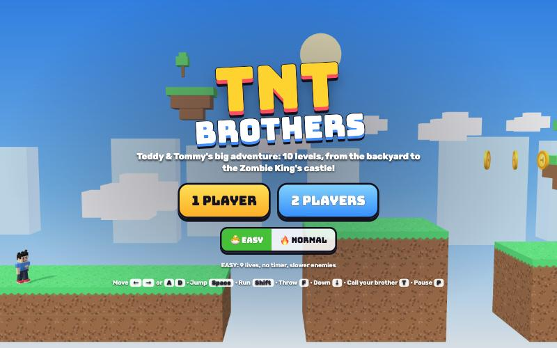

# TNT Brothers

[](https://adong.github.io/tnt-brothers/)

Press **?** any time (or tap the round **?** button on the left edge) to see the keys. The game waits while you look.
Tap the language button under it (the A文 icon) to switch between English and 中文; the dashboard and every game remember the choice.

A side-scrolling platformer in the spirit of the classic arcade ones, starring Teddy and Tommy as the **TNT Brothers** (TNT = Teddy & Tommy). Run, jump, bonk blocks, stomp silly zombies and robots, and make it through 10 levels, from the backyard to the Zombie King's castle. It's built with Claude Code from plain JavaScript and Three.js, on the shared Claude Games kit.
There are no image, model or audio files: the brothers and everyone else are the kit's blocky characters, every texture is painted on a canvas, and every sound is synthesised.
It's silly, not scary: stomped zombies go flat with stars, a bonked brother sits down dizzy, and nothing is ever gory.

## Play

- **Double-click `index.html`.** It works offline because Three.js and the kit are copied into `kit/`. Without internet the title font falls back to Arial Black.
- **Send one file:** `dist/tnt-brothers.html` is the whole game inlined. AirDrop or email it, then open it in a browser.
- Rebuild that file after any edit: `python3 kit/tools/bundle.py . --name tnt-brothers`
- Unlocked levels and the best score per level are saved in the browser, separately for `index.html` and `dist/tnt-brothers.html`.

**1 PLAYER**: pick Teddy or Tommy. **2 PLAYERS**: Teddy and Tommy together on one keyboard (co-op). Then pick a level on the world map.

- **🐣 EASY** (the default, for little ones): 9 lives, no clock, slower enemies, longer star power, slower platforms.
- **🔥 NORMAL**: 5 lives, 300 seconds per level, full-speed enemies. Time left at the flag is a bonus.

## Controls

| | Player 1 | Player 2 (co-op) | Touch |
|---|---|---|---|
| walk | ← → or A D | J L | ◀ ▶ |
| jump (hold for higher) | Space, W or ↑ | U or I | JUMP |
| run | Shift | H or ; | keep holding ◀ or ▶ |
| throw (🏀 power) | F | O | 🏀 |
| go down a vent | ↓ or S | K | ▼ |
| call your brother / high five | T | T | tap his face (top right) |

- In 1 player both key sets work, so the right hand can use J L U O too.
- **P** or Esc pauses, **M** turns the sound on or off. The ❚❚ and 🔊 buttons do the same.
- **Menus:** Enter or 1 starts 1 player, 2 starts 2 players, ← → pick EASY or NORMAL. On the map, arrows pick a level and Enter plays it.
- On a phone, turn it sideways. Buttons are big enough for small thumbs on an iPad.

## How to play

- **Stomp** enemies by landing on them. Walking into one hurts.
- **Bump blocks from below.** "TT" blocks hold a coin or a power-up. Big brothers break bricks; some bricks hold lots of coins, so keep bumping. A few blocks are hidden: jump where you think one might be.
- **Vents** (the metal pipes): the ones with a yellow-and-black rim lead down to a **bonus room** full of coins. Stand on top and press ↓. Another vent in the bonus room brings you back.
- **Coins:** 100 coins give an extra life.
- **Getting hit** when big makes you small again (with 🏀 power you drop back to plain big first). Getting hit when small, falling into a pit or running out of time costs a life: you sit down dizzy under circling stars, then start again from the last 🚩 checkpoint you passed. Lose all your lives and you get a fresh set; the levels you've unlocked stay unlocked.
- **The flagpole** ends a level. Jump onto it as high as you can for up to 5,000 points. Then your brother celebrates at the TNT clubhouse: **Teddy** shadow-boxes Mike Tyson style and sinks a 🏀 jump shot into the hoop (SWISH!), **Tommy** does his Y pose with peace fingers.

### Power-ups

| | What it does |
|---|---|
| 🍦 ice cream | You grow big. |
| 🏀 basketball power | Comes out of a power-up block when you're already big. **Teddy** throws bouncing basketballs (his jump shot), **Tommy** throws ✌️ stars that fly straight. Two at a time. |
| ⭐ star | 10 seconds of rainbow invincibility (12 on EASY): anything you touch gets bonked. |
| 💚 1-UP | An extra life, hiding in an invisible block. |

### Who you'll meet

- **Zombies** waddle along with their arms out. Stomp them flat.
- **Robots** (Bolt's cousins) fold up into a box when stomped. Touch the box to kick it sliding: it bonks everything in its way and never hurts you. Leave it alone and it unfolds again.
- **Bouncing balls** bounce along. Stomp them (POP!) or slip underneath.
- **Snappy plants** live in some vents. They duck down while you stand right next to their vent. You can't stomp them; throw something or use a star.
- **Drones** buzz back and forth in the air. Stomp them from above.
- **The Zombie King** waits at the end of level 10, crown and cape and all. He walks toward you and hops. Stomp him 3 times (he's dizzy for a moment after each one) and the gate to the last flag opens.
- **Spinning star bars** in the castle: time your run.

## The levels

| # | Level | World | What's new |
|---|---|---|---|
| 1 | Backyard Hop | backyard & park | the tutorial: tips pop up as you go |
| 2 | Park Party | backyard & park | robots, snappy plants, a star |
| 3 | Playground Picnic | backyard & park | bouncing balls, coin bricks, bigger gaps |
| 4 | Subway Station | under the subway | low ceilings, a big bonus vault |
| 5 | Tunnel Express | under the subway | moving platforms over the tracks, drones, a lift |
| 6 | Treetop Trail | sky & treetops | branches you jump up through |
| 7 | Cloud Hop | sky & treetops | lifts and moving clouds |
| 8 | Sky Bridge | sky & treetops | long bridges, robots up high |
| 9 | Zombie Castle | zombie castle | spinning star bars |
| 10 | The Zombie King | zombie castle | the boss |

Level 1 is open from the start; clearing a level opens the next. The world map shows each level's best score.

## Call your brother (companion mode)

Your companion is the other brother: **Tommy** comes when Teddy plays, **Teddy** comes when Tommy plays. Call him with **T** or the big face button at the top right, as often as you like.

- He runs in and keeps up with you for about 10 seconds, following your path a step behind and jumping where you jumped.
- He says hi with his signature move: Teddy's Tyson-style jab and straight, Tommy's Y pose. When he leaves, Teddy waves goodbye with a 🏀 jump shot (SWISH!).
- He hops onto enemies near you and stomps them (BOP!), and grabs coins near him for you.
- He hands you a treat: a 🍦 💧 🧃 🍪 🍉 🍌 flies from his hand into yours ("🍦 ICE CREAM FROM TOMMY!"), and you carry it for a while.
- **He's got your back:** while he's there, one hit or one fall into a pit is saved. "TOMMY SAVED YOU!": a hit just bounces off (and bonks the enemy), and a fall gets you carried back up to solid ground. The bar under his face shows how long he stays.
- **Tap again while he's there** and he poses and hands over another treat.

**In co-op** the button (or T) is a **🙌 HIGH FIVE**: both brothers do their signature moves and get 4 seconds of star power. Then it needs 18 seconds to recharge (the bar under the faces).

### Co-op rules

- The camera follows whichever brother is in front. If the other one falls behind the left edge, he gets pulled along to his brother.
- Lives are shared. A brother who loses a life floats back in next to the other one in a bubble, as long as there are lives left.
- The first brother to grab the flagpole finishes the level for both, and both celebrate.

## Make it yours: editing levels

The levels are ASCII maps in **`js/levels.js`**, with the whole legend at the top of that file. Each level is a list of screens laid side by side, and a screen only needs its bottom rows. For example:

```
......?.................
........................
........................
........................
....B?BMB...............
........................
........................
................z.......
########################
########################
```

That's a row of bricks with a coin block and a power-up block, a high coin block above, and a zombie on the ground. `#` is ground, `B` brick, `?` coin block, `M` power-up block, `S` star block, `H` hidden coin block, `X` hard block, `o` coin, `-` a ledge you can jump up through, `[]`/`{}` vents (`V]` goes to the bonus room, `P]` has a plant), `~` and `!` moving platforms, `*` a star bar, `z r b d K` enemies, `k` a checkpoint, `@` the start and `F` the flagpole. Each level also has a name, a theme (`park`, `subway`, `sky`, `castle`), the clock time and tutorial tips.

After an edit, run the level check (below) to make sure every level can still be finished. It also prints a warning if a screen's lines aren't all the same width.

## How it's tested

The game is split so it can be tested without a browser. `js/engine.js` is the whole game as plain state, stepped 60 times a second, with no Three.js in it. `js/world.js` only draws what the engine says, and `js/game.js` does the menus, input, sound and HUD.

```bash
node tools/check.js            # the bot plays all 10 levels on NORMAL; every one must reach the flag
node tools/check.js --walk     # the same, never pressing run (like a little one on a touch screen)
node tools/check.js --broken   # proves the check can fail: a 14-tile hole (and nothing to bounce on) is cut into each level
node tools/scenarios.js        # 24 small scenes: stomps, blocks, power-ups, the companion, co-op, the boss
```

- **The bot** (`js/bot.js`) is a beam search over the real engine. Every 0.1 s of game time it tries 10 button combinations (walk, run, jump, wait, back up, throw) from each of the ~150 most promising positions so far, throws away every line where it loses a life, and keeps going until it touches a flagpole. It never calls the companion and never needs the star, so every level is beatable on its own, small and on NORMAL. Its winning runs are saved to `js/demos.js` and replayed behind the title screen and the map.
- At the last check, all 10 levels passed both ways: with running (about 15–22 s of game time each) and walking only (about 24–36 s each). The `--broken` run failed all 10, each one stopping right at the edge of the hole, as it should.
- The first `--broken` run "passed" level 6 anyway: a drone hovers over that spot, and the bot stomped it in mid-air and bounced across the hole. The broken version now also takes away enemies and platforms in the hole.
- The walking check found a real problem on level 5, where two moving platforms were always 5 tiles apart. Neighbouring platforms now swing in opposite directions and meet in the middle.

Console hooks (`window.game`), for testing in a browser:

```js
game.start(3, { ch: 'tommy', easy: false, pow: 2 })  // jump straight into level 3 as big Tommy with 🏀 power
game.start(1, { players: '2p' })                     // co-op
game.demo(10)              // replay the bot's winning run of level 10 for real, with the HUD and sound
game.step(5)               // advance 5 s and draw (when the tab's animation is throttled)
game.hold(true)            // stop the live loop, so only game.step() moves time
game.buddy()               // call your brother (or high five in co-op)
game.input(0, { r: 1, run: 1 })   // hold buttons for player 1 (game.input(0, {}) lets go)
game.teleport(80, 6)       // move player 1
game.check(4)              // run the level bot in the browser
game.unlockAll()           // open every level on the map
game.state()               // a summary: positions, lives, coins, the companion...
```

## Files

```
index.html          the page: HUD, menus, world map, touch buttons (CSS inline)
js/title.js         the game's name, in one constant
js/levels.js        the 10 levels as ASCII maps, plus the bonus rooms
js/engine.js        the game rules: physics, blocks, enemies, power-ups, vents, the companion, co-op, the boss
js/bot.js           the level bot (beam search) and demo playback
js/demos.js         the bot's winning runs (written by tools/check.js)
js/world.js         the Three.js scene: tiles, enemies, the brothers, effects, the camera
js/art.js           themes, canvas textures, models (ball, drone, plant, flag, clubhouse) and scenery
js/poses.js         extra poses: idle, skid, dizzy sit, flagpole hang, toss, high five, the victory dance
js/sfx.js           sounds built on Kit.sound.tone / hiss
js/game.js          menus, input, HUD, the loop, saving, console hooks
js/keys.js          the keys the ? panel shows (Kit.help)
js/zh.js            中文 for every word on screen, the level names, the tips and the word bursts (Kit.lang)
tools/check.js      the headless level check (node)
tools/scenarios.js  the headless mechanics check (node)
kit/                the shared Claude Games kit (synced copy; edit it in ~/claude-games/kit)
dist/               the single-file build
```

## Not checked

- Sound was never listened to: every effect is called without errors, but nobody has heard them.
- Touch was tested with simulated touches in a desktop browser at iPad and phone sizes, not on a real iPad or phone.

## Kit candidates

Written in this game's own JS, and maybe useful in the kit later:

- `js/poses.js`: idle, skid, dizzySit, hang, toss, hi5, carry, cheer, plus `TNT.celebration(ch, t)` (Teddy boxes then shoots, Tommy does the Y).
- `js/world.js` `makeParticles`: the point-sprite pool with colour, fade and gravity, same idea as Metro Surfer's.
- `js/art.js`: a comic burst texture with a word in it (POW!, BOP!, BONK!), a basketball-hoop clubhouse, a beach ball with eyes, a drone, a snappy plant.
- `js/sfx.js`: stomp, block bump, brick break, sprout, shrink, vent whoosh, kick, 1-UP, checkpoint, dizzy, flag, level-clear fanfare, high five, boss sounds.
